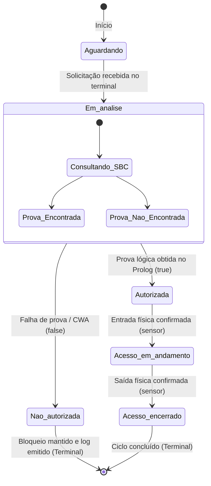

# PROJETO ATLAS ACCESS · DOSSIÊ TÉCNICO OFICIAL
## Sistema Baseado em Conhecimento (SBC) para Controle de Acesso a Áreas Industriais
**Instituição:** Faculdade de Tecnologia SENAI Antonio Adolpho Lobbe, São Carlos/SP  
**Curso:** Pós-Graduação Lato Sensu em Inteligência Artificial  
**Unidades Curriculares Integradas:** Lógica para Inteligência Artificial & Sistemas Baseados em Conhecimento  
**Situação de Aprendizagem 01 (SA01)**  
**Equipe:** Fábio, Fabi, Jonas Poli, Luciano  

---

## 1. CARACTERIZAÇÃO DO PROBLEMA (ETAPA 1)

O problema consiste em avaliar a elegibilidade e conformidade de solicitações de acesso a áreas industriais da Indústria Atlas, a partir de políticas de segurança extraídas de instruções de trabalho em linguagem natural, produzindo não apenas uma decisão binária, mas a **trilha completa de justificativa e explicação**.

### 1.1 Classificação nas Duas Camadas do Domínio

| Dimensão a Analisar | Classificação | Justificativa Técnica |
|:---|:---|:---|
| **Camada Estrutural: Observabilidade** | **Totalmente Observável na Base** | Todos os atributos, categorias e condições das pessoas e das áreas considerados nas regras estão explicitamente cadastrados no banco de fatos da base de conhecimento. |
| **Camada Estrutural: Determinismo** | **Determinístico** | Diante dos mesmos fatos e do mesmo conjunto de regras lógicas, o motor de inferência dedutivo chegará invariavelmente ao mesmo resultado e à mesma prova. |
| **Camada Estrutural: Dinâmica Temporal** | **Estático na Consulta** | Cada decisão é tomada avaliando um snapshot (retrato congelado) do cadastro no momento exato em que a solicitação é submetida ao sistema. |
| **Camada Estrutural: Espaço de Estados** | **Discreto** | Pessoas, categorias (funcionário, prestador, visitante), condições (credencial, treinamento, autorização) e áreas industriais são variáveis discretas finitas e bem delimitadas. |
| **Camada Cognitiva: Tarefa Realizada** | **Diagnóstico / Classificação** | O sistema classifica a solicitação como elegível ou não elegível por meio da verificação de requisitos de conformidade com as políticas declaradas. |

### 1.2 Relação com Sistemas Baseados em Conhecimento Clássicos
A tarefa cognitiva de classificação e diagnóstico de elegibilidade assemelha-se estruturalmente a sistemas especialistas clássicos como o **MYCIN** (diagnóstico e recomendação baseados em regras heurísticas) e ao **R1/XCON** (verificação de restrições de compatibilidade e configuração). A essência do sistema é a separação rígida entre a **Base de Conhecimento** (fatos e regras do domínio) e o **Motor de Inferência** (mecanismo genérico de busca e unificação).

### 1.3 Diferença em Relação a Problemas de Busca em Espaço de Estados (Exemplo do AGV)
O problema do Atlas Access **NÃO é um problema de busca em espaço de estados voltado a planejamento de sequências de ações** (como o AGV estudado em aula, onde é necessário planejar um caminho geométrico entre nós de um grafo com custos associados). Aqui, trata-se de **dedução lógica direta**: não se busca uma rota até o destino, mas sim a verificação da existência de uma prova lógica de conformidade. A Máquina de Estados Finitos entra no projeto não para guiar o motor de inferência, mas para orquestrar o **ciclo de vida operacional da solicitação** perante o ambiente externo.

---

## 2. EXTRAÇÃO DO CONHECIMENTO A PARTIR DA FONTE (ETAPA 2)

Fonte textual analisada: Instrução de Trabalho IT-SEG-014 ("Circulação interna de pessoas", Indústria Atlas).

### 2.1 Tabela de Regras Extraídas da Fonte

| Regra | Enunciado Operacional da Regra | Trecho da Fonte de Origem (IT-SEG-014) |
|:---:|:---|:---|
| **R01** | Qualquer pessoa cadastrada no sistema tem livre acesso à Recepção. | *"A Recepção é área de livre atendimento e os visitantes permanecem nela durante toda a estadia."* |
| **R02** | Funcionário com credencial válida tem acesso autorizado ao Escritório Administrativo. | *"O Escritório Administrativo é destinado ao pessoal próprio: qualquer funcionário da casa que esteja com a credencial válida pode entrar."* |
| **R03** | Funcionário com credencial válida e treinamento concluído tem acesso ao Laboratório Técnico. | *"No Laboratório, além da credencial, exigimos o treinamento concluído para os funcionários..."* |
| **R04** | Prestador de serviço com credencial válida, treinamento e autorização especial tem acesso ao Laboratório Técnico. | *"...para prestadores de serviço, além do treinamento, exigimos também a autorização especial emitida pela Segurança do Trabalho."* |
| **R05** | Funcionário com credencial válida, treinamento e autorização especial tem acesso à Área de Produção. | *"Na Área de Produção o critério é o mais rigoroso: credencial, treinamento e autorização especial, e isso vale igualmente para funcionários e para prestadores."* |
| **R06** | Prestador com credencial válida, treinamento e autorização especial tem acesso à Área de Produção. | *"...e isso vale igualmente para funcionários e para prestadores."* |

### 2.2 Registro das Decisões de Modelagem

| Ponto Identificado na Fonte | Trecho da Fonte | Decisão da Equipe | Justificativa Técnica |
|:---|:---|:---|:---|
| **Condição Repetida / Redundância** | *"Reforçando: crachá vencido não entra em área controlada de jeito nenhum"* e *"ninguém entra em área controlada sem credencial válida."* | Modelar unicamente a condição positiva `credencial_valida(X)`. Crachá vencido é a ausência desse predicado positivo. | Na lógica proposicional e no Prolog sob a Presunção de Mundo Fechado (CWA), a negação explícita ou regras negativas adicionais são desnecessárias e geram redundância. A ausência do fato positivo impede a satisfação do antecedente. |
| **Expressão Ambígua** | *"O Escritório Administrativo é destinado ao pessoal próprio: qualquer funcionário da casa que esteja com a credencial válida pode entrar."* | Adotar a leitura operacional de **condição suficiente** para funcionários: `(F ∧ C) -> AE`. Não declarar exclusividade ontológica estrita. | A expressão "qualquer funcionário... pode entrar" estabelece uma garantia de suficiência. Não interpretar como bicondicional ou exclusividade absoluta permite que a política evolua no futuro (como de fato ocorre na Etapa 10 Parte B para prestadores). |
| **Assunto sem Definição (Lacuna)** | *"Quanto aos estagiários, ainda estamos definindo o procedimento com o RH."* | **Nenhuma regra inventada.** Sem procedimentos cadastrados, nenhum acesso além da Recepção é derivável para estagiários. | Respeito estrito à orientação O3 da SA01: onde a fonte é omissa, nada é derivável. Sob a Presunção de Mundo Fechado, qualquer consulta sobre estagiários falhará naturalmente por ausência de prova. |

---

## 3. FORMALIZAÇÃO LÓGICA (ETAPA 3)

### 3.1 Dicionário de Proposições Atômicas

* $F$: O indivíduo é funcionário.
* $P$: O indivíduo é prestador de serviço.
* $V$: O indivíduo é visitante.
* $U$: O indivíduo é pessoa cadastrada no sistema ($U \equiv F \lor P \lor V$).
* $C$: O indivíduo possui credencial válida.
* $T$: O indivíduo possui treinamento concluído.
* $S$: O indivíduo possui autorização especial emitida pela Segurança do Trabalho.

**Conclusões (Áreas de Acesso):**
* $AR$: Acesso autorizado à Recepção (A01).
* $AE$: Acesso autorizado ao Escritório Administrativo (A02).
* $AL$: Acesso autorizado ao Laboratório Técnico (A03).
* $AP$: Acesso autorizado à Área de Produção (A04).

### 3.2 Formalização das Regras em Lógica Proposicional

* **R01 (Recepção):** $U \to AR$
* **R02 (Escritório - Funcionário):** $(F \land C) \to AE$
* **R03 (Laboratório - Funcionário):** $(F \land C \land T) \to AL$
* **R04 (Laboratório - Prestador):** $(P \land C \land T \land S) \to AL$
* **R05 (Produção - Funcionário):** $(F \land C \land T \land S) \to AP$
* **R06 (Produção - Prestador):** $(P \land C \land T \land S) \to AP$

### 3.3 Verificação Semântica da Regra R05 (Tabela-Verdade de 32 Linhas)
Seja a regra R05: $(F \land C \land T \land S) \to AP$.  
Definimos o antecedente $H = F \land C \land T \land S$.

```
Nº  |  F  |  C  |  T  |  S  | AP  |  H  | H -> AP | Interpretação Semântica
----+-----+-----+-----+-----+-----+-----+---------+-------------------------------------------------------------
 1  |  1  |  1  |  1  |  1  |  1  |  1  |    1    | Condições satisfeitas e acesso concedido (Modus Ponens)
 2  |  1  |  1  |  1  |  1  |  0  |  1  |    0    | VIOLAÇÃO DA REGRA (Premissas atendidas, mas acesso barrado)
 3  |  1  |  1  |  1  |  0  |  1  |  0  |    1    | Antecedente falso; implicação vacilamente verdadeira
 4  |  1  |  1  |  1  |  0  |  0  |  0  |    1    | Antecedente falso; implicação vacilamente verdadeira
 5  |  1  |  1  |  0  |  1  |  1  |  0  |    1    | Antecedente falso; implicação vacilamente verdadeira
 6  |  1  |  1  |  0  |  1  |  0  |  0  |    1    | Antecedente falso; implicação vacilamente verdadeira
 7  |  1  |  1  |  0  |  0  |  1  |  0  |    1    | Antecedente falso; implicação vacilamente verdadeira
 8  |  1  |  1  |  0  |  0  |  0  |  0  |    1    | Antecedente falso; implicação vacilamente verdadeira
 9  |  1  |  0  |  1  |  1  |  1  |  0  |    1    | Antecedente falso; implicação vacilamente verdadeira
10  |  1  |  0  |  1  |  1  |  0  |  0  |    1    | Antecedente falso; implicação vacilamente verdadeira
11  |  1  |  0  |  1  |  0  |  1  |  0  |    1    | Antecedente falso; implicação vacilamente verdadeira
12  |  1  |  0  |  1  |  0  |  0  |  0  |    1    | Antecedente falso; implicação vacilamente verdadeira
13  |  1  |  0  |  0  |  1  |  1  |  0  |    1    | Antecedente falso; implicação vacilamente verdadeira
14  |  1  |  0  |  0  |  1  |  0  |  0  |    1    | Antecedente falso; implicação vacilamente verdadeira
15  |  1  |  0  |  0  |  0  |  1  |  0  |    1    | Antecedente falso; implicação vacilamente verdadeira
16  |  1  |  0  |  0  |  0  |  0  |  0  |    1    | Antecedente falso; implicação vacilamente verdadeira
17  |  0  |  1  |  1  |  1  |  1  |  0  |    1    | Antecedente falso; implicação vacilamente verdadeira
18  |  0  |  1  |  1  |  1  |  0  |  0  |    1    | Antecedente falso; implicação vacilamente verdadeira
19  |  0  |  1  |  1  |  0  |  1  |  0  |    1    | Antecedente falso; implicação vacilamente verdadeira
20  |  0  |  1  |  1  |  0  |  0  |  0  |    1    | Antecedente falso; implicação vacilamente verdadeira
21  |  0  |  1  |  0  |  1  |  1  |  0  |    1    | Antecedente falso; implicação vacilamente verdadeira
22  |  0  |  1  |  0  |  1  |  0  |  0  |    1    | Antecedente falso; implicação vacilamente verdadeira
23  |  0  |  1  |  0  |  0  |  1  |  0  |    1    | Antecedente falso; implicação vacilamente verdadeira
24  |  0  |  1  |  0  |  0  |  0  |  0  |    1    | Antecedente falso; implicação vacilamente verdadeira
25  |  0  |  0  |  1  |  1  |  1  |  0  |    1    | Antecedente falso; implicação vacilamente verdadeira
26  |  0  |  0  |  1  |  1  |  0  |  0  |    1    | Antecedente falso; implicação vacilamente verdadeira
27  |  0  |  0  |  1  |  0  |  1  |  0  |    1    | Antecedente falso; implicação vacilamente verdadeira
28  |  0  |  0  |  1  |  0  |  0  |  0  |    1    | Antecedente falso; implicação vacilamente verdadeira
29  |  0  |  0  |  0  |  1  |  1  |  0  |    1    | Antecedente falso; implicação vacilamente verdadeira
30  |  0  |  0  |  0  |  1  |  0  |  0  |    1    | Antecedente falso; implicação vacilamente verdadeira
31  |  0  |  0  |  0  |  0  |  1  |  0  |    1    | Antecedente falso; implicação vacilamente verdadeira
32  |  0  |  0  |  0  |  0  |  0  |  0  |    1    | Antecedente falso; implicação vacilamente verdadeira
```

#### Análise da Implicação Material e a Pergunta Fundamental da Etapa 3:
1. **Em quantas linhas o antecedente é verdadeiro?** Apenas em **2 linhas** (Linhas 1 e 2, onde $F=1, C=1, T=1, S=1$).
2. **Em quantas a implicação inteira é verdadeira?** Em **31 linhas** de 32.
3. **Em qual linha a implicação é falsa?** Apenas na Linha 2 ($H=1$ e $AP=0$).
4. **O que significa uma linha em que o antecedente é falso e a implicação é verdadeira? Isso libera o acesso?**  
   **NÃO!** Na lógica matemática clássica, a implicação material $P \to Q$ é equivalente a $\neg P \lor Q$. Por definição formal, se $P$ é falso, a sentença composta é verdadeira por vacuidade (verdade vacínua).  
   Entretanto, em um Sistema Baseado em Conhecimento, **a inferência dedutiva exige a aplicação da regra de inferência MODUS PONENS**:
   $$\frac{P \to Q, \quad P}{\therefore Q}$$
   Se a premissa fática $P$ não for verdadeira, o Modus Ponens não pode ser aplicado, a regra não dispara, $Q$ não é derivado e o acesso **permanece bloqueado**. Essa distinção crucial separa a sintaxe proposicional da semântica operacional do SBC.

---

## 4. VALIDAÇÃO LÓGICA DOS SEIS CASOS OBRIGATÓRIOS (ETAPA 4)

| Caso | Pessoa | Área Solicitada | Regra Aplicável | Atribuição de Valores | Antecedente Satisfeito? | Conclusão Dedutiva e Justificativa |
|:---:|:---|:---|:---:|:---|:---:|:---|
| **C01** | Ana | Produção | R05 | $F=1, C=1, T=1, S=1$ | **SIM** | **Autorizado ($AP=1$).** Todos os requisitos atendidos; Modus Ponens válido. |
| **C02** | Bruno | Laboratório | R03 | $F=1, C=1, T=0$ | **NÃO** | **Não demonstrado.** Falta treinamento ($T=0$). Modus Ponens não se aplica. |
| **C03** | Carla | Laboratório | R04 | $P=1, C=1, T=1, S=1$ | **SIM** | **Autorizado ($AL=1$).** Requisitos de prestador atendidos integralmente. |
| **C04** | Diego | Produção | R06 | $P=1, C=1, T=1, S=0$ | **NÃO** | **Não demonstrado.** Falta autorização especial ($S=0$). |
| **C05** | Elisa | Laboratório | *Inexistente* | $V=1, C=1, T=0, S=0$ | **NÃO** | **Não demonstrado.** Inexiste regra que autorize visitante em área controlada. |
| **C06** | Fernando | Produção | R05 | $F=1, C=0, T=1, S=1$ | **NÃO** | **Não demonstrado.** Crachá vencido / falta credencial válida ($C=0$). |

---

## 5. MÁQUINA DE ESTADOS DA SOLICITAÇÃO DE ACESSO (ETAPA 5)

A evolução operacional de cada solicitação de acesso foi modelada como uma Máquina de Estados Finitos (FSM).

### 5.1 Diagrama de Estados (Mermaid)



### 5.2 Tabela de Transições e Ações Operacionais

| Estado Atual | Evento / Condição | Próximo Estado | Ação Operacional Realizada |
|:---|:---|:---|:---|
| **Aguardando** | Solicitação recebida no terminal de acesso | **Em análise** | Coletar identificador da pessoa e área alvo; disparar consulta dedutiva na base. |
| **Em análise** | Avaliação concluída com prova lógica na base (`true`) | **Autorizada** | Emitir comando elétrico para destravamento da catraca/porta; registrar trilha de sucesso. |
| **Em análise** | Avaliação concluída sem prova lógica na base (`false` / CWA) | **Não autorizada** | Manter bloqueio eletromecânico; apresentar justificativa da recusa na tela do terminal. |
| **Autorizada** | Passagem física confirmada (sensores da catraca) | **Acesso em andamento** | Registrar timestamp de entrada e acionar temporizador de monitoramento de permanência. |
| **Acesso em andamento** | Passagem de saída confirmada (sensores de saída) | **Acesso encerrado** | Registrar timestamp de saída e fechar sessão de auditoria de presença. |

---

## 6. MODELAGEM DA BASE DE CONHECIMENTO (ETAPA 6)

### 6.1 Separação Ontológica: Fatos, Regras e Conclusões Inferidas

* **Fatos Declarados:** Instâncias pontuais e afirmativas sobre indivíduos conhecidos (`pessoa/1`, `funcionario/1`, `prestador/1`, `visitante/1`, `credencial_valida/1`, `treinamento_concluido/1`, `autorizacao_especial/1`).
* **Regras Operacionais:** Implicações lógicas gerais independentes de instâncias específicas (`acesso/2`), formalizando o conhecimento normativo.
* **Conclusões Inferidas:** Resultados dedutivos gerados em tempo de execução pela unificação do motor de inferência (ex.: `acesso(ana, producao)` deriva `true`).

### 6.2 Por que a autorização não deve ser declarada diretamente como fato?
Se a autorização de cada pessoa fosse declarada diretamente como um fato (ex.: `autorizado_producao(ana).`), o sistema perderia a sua natureza de **Sistema Baseado em Conhecimento**. Ele se degeneraria em uma tabela estática de lookup. Descrever conhecimento por meio de regras permite desacoplar a política das instâncias: se uma política de segurança mudar, alteram-se apenas as regras; se uma credencial for revogada, remove-se apenas o fato de credencial, e o sistema recalcula a elegibilidade em tempo real.

---

## 7. MOTOR DE INFERÊNCIA, UNIFICAÇÃO E TRACE (ETAPAS 7 E 8)

### 7.1 Algoritmo de Unificação Sintática
Na execução de `acesso(ana, producao)`, aplicam-se:
1. **Estruturas compatíveis:** o objetivo unifica com a cabeça da regra R05 `acesso(X, producao)`.
2. **Constantes iguais:** o segundo argumento `producao` unifica com `producao`.
3. **Variável com termo:** a variável livre `X` unifica com o átomo `ana`, ligando `X = ana` em todo o corpo da cláusula.

### 7.2 Ordem de Busca
* **Cláusulas no arquivo:** Busca de cima para baixo.
* **Objetivos no corpo:** Avaliação da esquerda para a direita.

### 7.3 Backtracking e Modelo de Caixa de 4 Portas de Byrd

#### Caso de Sucesso: `acesso(ana, producao)`
* `Call: acesso(ana, producao)`
* `Call: funcionario(ana)` $\to$ `Exit: funcionario(ana)` (Fato encontrado)
* `Call: credencial_valida(ana)` $\to$ `Exit: credencial_valida(ana)` (Fato encontrado)
* `Call: treinamento_concluido(ana)` $\to$ `Exit: treinamento_concluido(ana)` (Fato encontrado)
* `Call: autorizacao_especial(ana)` $\to$ `Exit: autorizacao_especial(ana)` (Fato encontrado)
* `Exit: acesso(ana, producao)` $\to$ **Resultado: true**  
*(Não ocorreu backtracking: o primeiro caminho da árvore foi bem-sucedido).*

#### Caso de Falha e Backtracking: `acesso(diego, producao)`
1. Motor tenta a regra R05: `Call: funcionario(diego)` $\to$ **Fail** (Diego é prestador).
2. Ocorre **Backtracking**: o motor retorna à porta **Redo** em `acesso(diego, producao)` e busca a próxima cláusula no arquivo, encontrando a regra R06.
3. Em R06: `prestador(diego)` $\to$ **Exit**; `credencial_valida(diego)` $\to$ **Exit**; `treinamento_concluido(diego)` $\to$ **Exit**.
4. Em R06: `Call: autorizacao_especial(diego)` $\to$ **Fail** (Diego não possui autorização especial cadastrada).
5. Como não há mais cláusulas de produção no arquivo, o motor retorna **Fail** $\to$ **Resultado: false**.

### 7.4 Presunção de Mundo Fechado (Closed World Assumption - CWA)
O retorno `false` em Diego ou Elisa **não prova** que no universo real é impossível que tenham acesso. Expressa exclusivamente que, dentro dos limites da base declarada, a afirmação não pode ser deduzida.

---

## 8. MATRIZ DE VALIDAÇÃO CRUZADA E TRILHA DE EXPLICAÇÃO (ETAPA 9)

| Caso | Regra e Expressão Lógica | Consulta e Resultado | Fatos e Regra que Sustentam / Condição Decisiva | Estado FSM Resultante | Frase de Justificativa ao Usuário |
|:---:|:---|:---|:---|:---:|:---|
| **C01** | **R05:** $(F \land C \land T \land S) \to AP$ | `acesso(ana, producao)` $\to$ `true` | `funcionario(ana)`, `credencial_valida(ana)`, `treinamento_concluido(ana)`, `autorizacao_especial(ana)` | **Autorizada** | *"Acesso autorizado à Área de Produção para Ana: funcionária com credencial válida, treinamento e autorização especial (Regra R05)."* |
| **C02** | **R03:** $(F \land C \land T) \to AL$ | `acesso(bruno, laboratorio)` $\to$ `false` | Falta `treinamento_concluido(bruno)` ($T=0$) | **Não autorizada** | *"Acesso não autorizado ao Laboratório Técnico para Bruno: embora seja funcionário com credencial válida, não concluiu o treinamento obrigatório (Regra R03)."* |
| **C03** | **R04:** $(P \land C \land T \land S) \to AL$ | `acesso(carla, laboratorio)` $\to$ `true` | `prestador(carla)`, `credencial_valida(carla)`, `treinamento_concluido(carla)`, `autorizacao_especial(carla)` | **Autorizada** | *"Acesso autorizado ao Laboratório Técnico para Carla: prestadora com credencial válida, treinamento e autorização especial (Regra R04)."* |
| **C04** | **R06:** $(P \land C \land T \land S) \to AP$ | `acesso(diego, producao)` $\to$ `false` | Falta `autorizacao_especial(diego)` ($S=0$) | **Não autorizada** | *"Acesso não autorizado à Área de Produção para Diego: prestador com credencial e treinamento, mas sem autorização especial emitida pela Segurança do Trabalho (Regra R06)."* |
| **C05** | *Inexistente na base* | `acesso(elisa, laboratorio)` $\to$ `false` | Elisa é visitante; inexiste regra para visitantes fora da Recepção | **Não autorizada** | *"Acesso não autorizado ao Laboratório Técnico para Elisa: visitantes permanecem na Recepção durante toda a estadia; não há regra autorizativa."* |
| **C06** | **R05:** $(F \land C \land T \land S) \to AP$ | `acesso(fernando, producao)` $\to$ `false` | Falta `credencial_valida(fernando)` ($C=0$ - crachá vencido) | **Não autorizada** | *"Acesso não autorizado à Área de Produção para Fernando: funcionário com crachá vencido / sem credencial válida cadastrada (Regra R05)."* |

---

## 9. EVOLUÇÃO DA BASE DE CONHECIMENTO (ETAPA 10)

### 9.1 Parte A: Alteração de um Fato
* **Cenário:** Bruno conclui o treinamento de segurança.
* **Alteração:** Adicionado o fato `treinamento_concluido(bruno).`
* **Impacto Lógico:** O antecedente da regra R03 passa a ser satisfeito ($F=1, C=1, T=1$).
* **Comportamento da Consulta:** `acesso(bruno, laboratorio)` transita de `false` para `true`.
* **Transição na FSM:** Da solicitação transita de `Em análise` para `Autorizada`.

### 9.2 Parte B: Incorporação de Nova Política (Regra R07)
* **Comunicado da Segurança do Trabalho:** *"A partir deste mês, prestadores de serviço com credencial válida e treinamento concluído também podem acessar o Escritório Administrativo."*
* **Formalização Lógica:** $(P \land C \land T) \to AE$
* **Implementação Modular:**
  ```prolog
  % R07 (Nova politica - Etapa 10 Parte B)
  acesso(X, escritorio) :-
      prestador(X),
      credencial_valida(X),
      treinamento_concluido(X).
  ```
* **Análise da Diferença Declarativo vs Procedural:**
  * Foram necessárias apenas **4 linhas** de código.
  * **Nenhuma regra existente precisou ser modificada ou refatorada.**
  * Em um paradigma procedural convencional (ex.: encadeamentos de `if/else`), seria necessário modificar o fluxo central de controle, testar regressões e correr o risco de introduzir bugs laterais. Na programação declarativa em SBC, a base de conhecimento cresce de forma modular e ortogonal.

---

## 10. NOVO CASO CRIADO PELA EQUIPE (ETAPA 11 - C07)

* **Indivíduo:** Gustavo
* **Perfil:** Funcionário recém-admitido com credencial válida e treinamento concluído, mas que ainda não obteve autorização especial da Segurança do Trabalho.
* **Fatos cadastrados:**
  ```prolog
  pessoa(gustavo).
  funcionario(gustavo).
  credencial_valida(gustavo).
  treinamento_concluido(gustavo).
  % autorizacao_especial(gustavo) omitida sob a CWA (S = 0)
  ```
* **Ciclo de Avaliação:**
  1. Consulta Laboratório: `acesso(gustavo, laboratorio)` $\to$ **true** (Satisfeito via R03: $F \land C \land T$).
  2. Consulta Produção: `acesso(gustavo, producao)` $\to$ **false** (Falha via R05 por falta de `autorizacao_especial(gustavo)`).
* **Validação na FSM:** Transita com sucesso para `Autorizada` no Laboratório e para `Não autorizada` na Produção.
* **Frase de Justificativa ao Usuário:**  
  *"Acesso autorizado ao Laboratório Técnico para Gustavo (Caso C07): funcionário com credencial válida e treinamento concluído, atendendo integralmente aos requisitos da regra R03."*

### 10.1 Mecanismo de Ativação e Desativação do Caso C07

Para permitir demonstrar à banca examinadora o comportamento do sistema **com** e **sem** o caso C07, foram projetados quatro métodos complementares:

#### Método 1: Ativação Dinâmica no REPL do Prolog (`assertz` e `retractall`)
No arquivo `slides_10_a_14.pl`, os predicados foram declarados com `:- dynamic ...`, permitindo modificar a base em tempo de execução sem reiniciar o SWI-Prolog:
```prolog
% Verificar o status atual:
?- status_c07.

% Ativar C07 (insere os fatos de Gustavo dinamicamente):
?- ativar_c07.
?- acesso(gustavo, laboratorio).   % Retorna: true
?- acesso(gustavo, producao).      % Retorna: false

% Desativar C07 (remove Gustavo da base):
?- desativar_c07.
?- acesso(gustavo, laboratorio).   % Retorna: false (CWA: fato não demonstrável)
```

#### Método 2: Pelo Painel Interativo CLI (`main.py`)
No menu principal do `main.py`, a tecla `T` alterna instantaneamente o caso C07:
```bash
python3 main.py
# Opção [T] ATIVAR / DESATIVAR Caso C07 (Gustavo)
# Opção 1: Exibe a Matriz de Validação Cruzada (com ou sem C07 conforme o status)
```

#### Método 3: Demonstração Direta na Linha de Comando (`apresentacao_jonas.py`)
Executa um teste automatizado demonstrando os três momentos: estado inicial sem C07, ativação e consultas, e desativação:
```bash
python3 apresentacao_jonas.py --c07
```

#### Método 4: Por Arquivos Estáticos Separados
* **Base Original sem C07:** `swipl src/atlas_access.pl` (contém estritamente C01 a C06).
* **Base Evoluída com C07:** `swipl src/atlas_access_evolucao.pl` (contém Gustavo cadastrado de forma persistente).

---

## 11. ANÁLISE CRÍTICA (ETAPA 12)

1. **Qual é a diferença entre fato, regra e conclusão inferida?**  
   Fato é uma proposição atômica assertiva declarada como verdadeira no domínio; regra é uma implicação lógica geral condicional que define relacionamentos e dependências; conclusão inferida é um fato derivado dinamicamente pelo motor de inferência através de unificação e resolução sobre as regras e fatos.

2. **Na tabela-verdade construída na Etapa 3, por que as linhas em que o antecedente é falso tornam a implicação verdadeira? Isso significa que o acesso está liberado?**  
   Pela definição clássica de implicação material ($P \to Q \equiv \neg P \lor Q$), quando $P$ é falso a sentença é logicamente verdadeira por vacuidade. Isso **não libera o acesso**, pois o raciocínio dedutivo requer Modus Ponens: sem a veracidade de $P$, a conclusão $Q$ jamais é instanciada.

3. **Qual tarefa cognitiva este protótipo realiza, e por que não é um problema de busca em espaço de estados?**  
   Realiza diagnóstico/classificação de conformidade. Não é busca em espaço de estados porque não envolve encontrar caminhos sequenciais com operadores de transição física (como rotas de um AGV), mas sim demonstrar a validade lógica de uma hipótese em uma base de regras.

4. **Como uma política falada por um especialista foi preservada na regra escrita, na expressão lógica e na regra Prolog? O que se perdeu no caminho?**  
   Preservou-se o núcleo de suficiência e as dependências condicionais necessárias. Perderam-se nuances discursivas, como o tom enfático ("de jeito nenhum"), as hesitações ("ainda estamos definindo com o RH") e o contexto temporal implícito.

5. **Qual foi a decisão de modelagem mais difícil da Etapa 2, e o que aconteceria se a equipe tivesse decidido de outra forma?**  
   A modelagem do acesso ao escritório ("destinado ao pessoal próprio"). Se a equipe tivesse modelado como bicondicional estrita ($F \leftrightarrow AE$), a expansão futura para prestadores (Etapa 10B) exigiria a destruição da regra anterior em vez de uma extensão modular.

6. **Qual é a função da máquina de estados neste sistema, e por que ela não substitui a base de conhecimento?**  
   A FSM orquestra a temporalidade e o ciclo de vida físico da solicitação (aguardando, análise, entrada, saída). Ela não substitui o SBC porque a FSM não possui capacidade de dedução declarativa; ela apenas reage ao veredito emitido pelo motor.

7. **O que significa uma consulta Prolog não ser demonstrada com a base disponível? Isso equivale a provar a negação clássica?**  
   Significa apenas que o motor não encontrou uma unificação bem-sucedida (falha de prova sob CWA). Não equivale à negação clássica $\neg P$, pois a ausência de registro na base não prova a falsidade ontológica no mundo real.

8. **Por que o caso de Elisa é conceitualmente diferente do caso de Diego?**  
   Para Diego, existe uma regra na base voltada à sua categoria (R06 para prestadores), mas falta uma condição factual ($S$). Para Elisa, **não existe nenhuma regra de acesso** a áreas controladas para a categoria Visitante.

9. **Onde houve backtracking nas consultas analisadas, e o que isso tem a ver com busca em um espaço de possibilidades?**  
   Houve backtracking na consulta de Diego: o motor tentou R05, falhou em `funcionario(diego)`, recuou e explorou a alternativa R06. Isso ilustra a busca em profundidade com backtracking cronológico em árvores de prova SLD.

10. **Sem a trilha de explicação, o que este sistema deixaria de oferecer a quem tem uma solicitação negada?**  
    Deixaria de oferecer transparência, auditoria e acionabilidade. Um usuário rejeitado receberia apenas um "Não", sem saber se o bloqueio decorreu de crachá vencido, falta de curso de segurança ou ausência de autorização formal.

11. **Quais limitações este protótipo possui?**  
    O protótipo opera sobre um modelo estático de fatos sem verificação automática de expiração de datas em tempo real, sem integração direta com leitores biométricos/sensores de catracas físicas e com tratamento manual das exceções de RH para estagiários.

